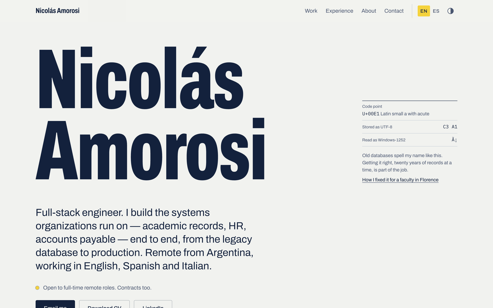
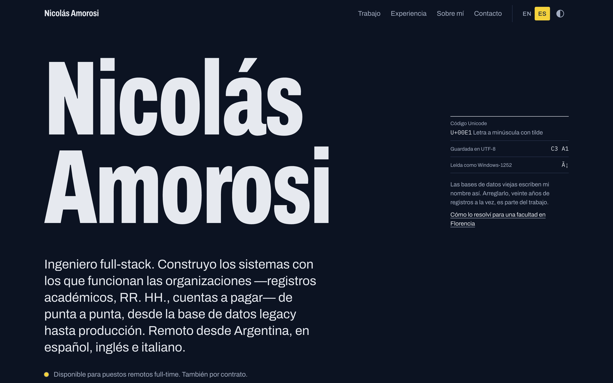
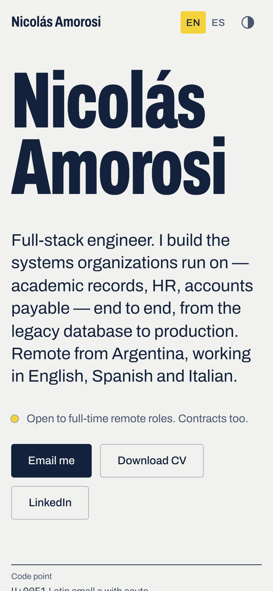
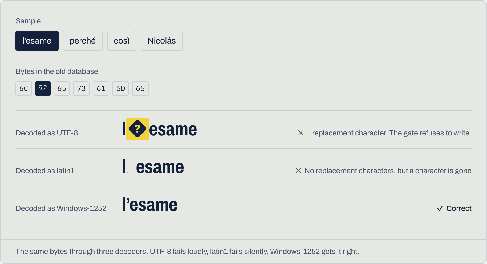

# nicolasamorosi.com

[](https://github.com/NicolasAmorosi/portfolio/actions/workflows/ci.yml)

Personal site of Nicolás Amorosi, full-stack engineer — **[nicolasamorosi.com](https://nicolasamorosi.com)**.



## The idea

Almost everything I build is private client code, so the site has to show how I think
rather than link to what I shipped. Its one bold gesture comes from my favourite case
study: on load the name renders as `Nicolás` — UTF-8 bytes read as Windows-1252, the way
old databases spell it — and decodes itself under a highlighter stroke. The rest stays quiet.

| Dark, in Spanish | Phone |
|---|---|
|  |  |

## What's inside

- **Five case studies** (problem → constraints → what I built → the hard part → result),
  each with its own drawing. Two figures are interactive:
  - an **encoding decoder** that runs the same bytes through UTF-8, strict latin1 and
    Windows-1252 with the browser's own `TextDecoder` — showing why one fails loudly, one
    fails silently and one gets it right;
  - a **scoped-permissions demo**: one request for grades, answered for a student, a
    teacher and the secretary's office.

  

- **Bilingual, typed content.** English at `/`, Spanish at `/es`. Long-form content is
  typed data where every string is `Record<Locale, string>`, so a missing translation is a
  compile error; interface strings are type-checked against the English messages.
- **Switching language keeps your place.** The element under the header is remembered by
  its DOM path and restored at the same offset in the other language (Spanish runs longer,
  so a raw scroll position would drift). Covered by an end-to-end test that fails without it.
- **Static everything.** Every page and Open Graph image is prerendered; client JavaScript
  only where something reacts to you.
- **Light and dark from one palette** with CSS `light-dark()` tokens — no `dark:` variants,
  no theme flash.

## Design system

| | |
|---|---|
| Color | Ink `#13213C` on paper `#F1F2EF`; paper on ink `#0C1322` at night. One accent, a highlighter yellow `#F4D23C`, always *behind* ink. |
| Type | [Archivo](https://github.com/Omnibus-Type/Archivo) variable — the width axis is the hierarchy: 62% display, 75% headings, 100% text. IBM Plex Mono only for literal code and bytes. Bringhurst's scale. |
| Layout | A margin column with sticky section titles and a content column. Work is an index of rows, not a grid of cards. |
| Motion | One orchestrated moment (the decode), once per visit. Everything else answers an action. Respects `prefers-reduced-motion`. |

## Quality

Lighthouse 12 against [nicolasamorosi.com](https://nicolasamorosi.com), home and case studies,
in both languages:

| | Performance | Accessibility | Best practices | SEO |
|---|---|---|---|---|
| Desktop | 100 | 100 | 100 | 100 |
| Mobile (simulated 4G) | 96 | 100 | 100 | 100 |

Every text/background pair passes WCAG AA (body text ≥ 6.5:1). Keyboard reachable with
visible focus and a skip link; layouts hold from 320 px. Per-page metadata with hreflang,
generated Open Graph images, sitemap, robots and JSON-LD. Security headers on every
response: HSTS, `nosniff`, frame denial, referrer and permissions policies.

## Stack

Next.js 16 (App Router, Turbopack) · React 19 · TypeScript in its strictest settings ·
Tailwind CSS 4 · next-intl 4 · `next/og` · Vitest · Playwright · GitHub Actions · Vercel.

```text
src/
├── app/[locale]/       # routes: home and projects/[slug], OG images per page
├── features/           # home, projects (index, case study, figures), experience
├── components/         # ui primitives and layout (header, footer, theme, locale)
├── content/            # typed bilingual data: projects, experience, profile
├── i18n/               # routing, request config, messages
└── lib/                # site constants, fonts, dates, metadata, OG renderer
e2e/                    # browser tests
```

## Running it

Requires Node 20.9+ and pnpm 10.

```bash
pnpm install
pnpm dev          # http://localhost:3000
pnpm lint
pnpm typecheck
pnpm test         # unit tests (Vitest)
pnpm test:e2e     # builds, serves on :3200 and runs Playwright with the installed Chrome
```

CI runs lint, type checks, unit and end-to-end tests on every push and pull request.

## License

The source code is [MIT](LICENSE). The written content — case studies, profile texts and the
CV — is © Nicolás Amorosi, all rights reserved. Archivo is used under the
[SIL Open Font License](src/assets/fonts/OFL.txt).
